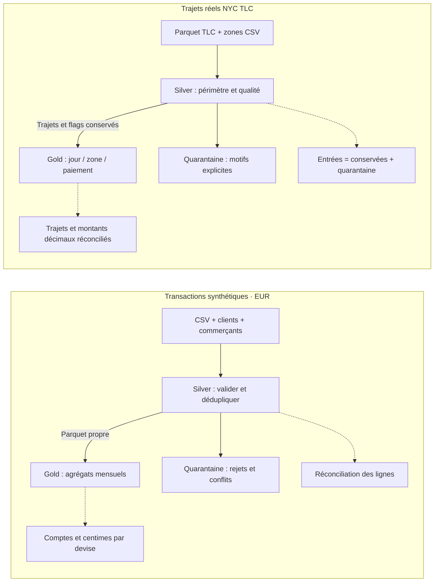
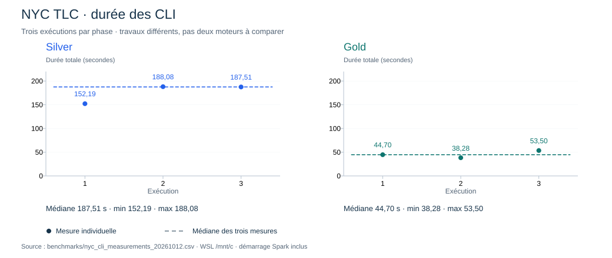
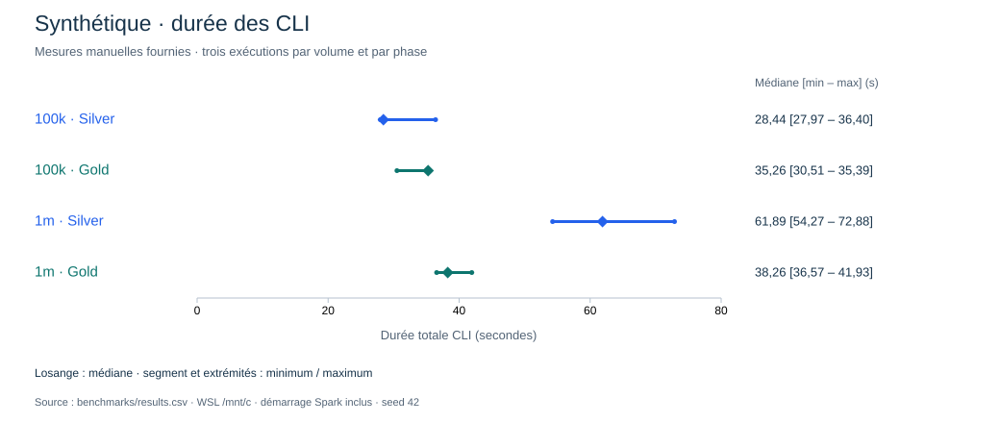

# TransactionFlow

**Des données brutes aux tables d’analyse, avec des contrôles à chaque étape.**
Projet pédagogique PySpark : transactions synthétiques et trajets réels NYC TLC.


Résultat **local**, sans CI configurée : 80 tests Spark et 9 tests du mesureur
réussis lors de vérifications distinctes. [Portée du badge](docs/setup.md#tests-et-portée-du-résultat-local).

## Sommaire

[Parcours](#parcours) · [Sorties utiles](#sorties) · [Qualité NYC](#qualite)
· [Démarrage](#demarrage) · [Performances](#performances) · [Documentation](#documentation)

<a id="parcours"></a>
## 🗂 Données et parcours

Le problème : rendre des fichiers bruts analysables sans perdre les anomalies,
multiplier les lignes par jointure ou fausser les totaux. Les deux parcours
partagent une organisation Silver → Gold, **avec des règles métier différentes**.



Synthétique : dates UTC, centimes entiers, doublons exacts supprimés.
NYC : heures civiles, montants décimaux, doublons et flags conservés.

<a id="sorties"></a>
## Σ Sorties utiles

| Parcours | Silver : qualité et traçabilité | Gold : tables d’analyse Parquet |
|---|---|---|
| Synthétique | `transactions_clean`, `transactions_rejected` | `merchant_monthly`, `customer_monthly` |
| NYC TLC | `trips_clean`, `trips_quarantined` | `daily_zone_payment` |

Chaque phase produit `quality_report.json`. Les tables propres et agrégées sont
partitionnées par `year/month` pour sélectionner les mois utiles.

<a id="qualite"></a>
## ✓ Qualité NYC — janvier 2025

| Étape | Lignes / groupes vérifiés localement |
|---|---:|
| Entrées Silver | 3 475 226 |
| Trajets conservés | 3 475 080 |
| En quarantaine | 146 |
| Groupes Gold | 22 979 |

Les 146 lignes : 124 fins avant départ, 22 départs hors janvier.
Gold représente tous les trajets conservés ; net enregistré : **89 001 305,87 USD**.
Flags ≠ fraude. Montants négatifs ≠ remboursements prouvés.

<a id="demarrage"></a>
## Démarrage rapide — clone neuf sous WSL

Depuis la racine du clone, avec **Python 3.13 et Java 21** disponibles :

```bash
python3.13 -m venv ~/.venvs/transactionflow
source ~/.venvs/transactionflow/bin/activate
python -m pip install -r requirements.txt
export PYSPARK_PYTHON="$VIRTUAL_ENV/bin/python"
export PYSPARK_DRIVER_PYTHON="$PYSPARK_PYTHON"
python generate_data.py --rows 10000 --seed 42 --output data/raw/quickstart
python run_silver.py --input data/raw/quickstart --output data/silver/quickstart
python run_gold.py --silver data/silver/quickstart/transactions_clean --references data/raw/quickstart --output data/gold/quickstart
```

Venv déjà présent : l’activer sans le recréer. Choisir des sorties nouvelles lors
d’une répétition. Arguments vérifiés dans les CLI ; commandes non relancées pour
cette mise à jour. Les données demo sont ignorées par Git et absentes d’un clone.

<details>
<summary>NYC, tests et Windows natif</summary>

Pour NYC, récupérer les deux fichiers officiels : [sources et commandes](docs/nyc_pipeline.md#préparer-les-fichiers-depuis-un-clone).
Les tests utilisent des fixtures temporaires : [installation et tests](docs/setup.md).
Windows natif reste limité par l’écriture Hadoop sans `HADOOP_HOME` / winutils ;
aucun binaire non vérifié n’a été ajouté. [Diagnostic observé](docs/setup.md#windows-natif--cmd).

</details>

<a id="performances"></a>
## ⏱ Performances locales

**Trois exécutions par série**, démarrage Spark inclus, WSL local, stockage sous `/mnt/c`.
Silver et Gold effectuent des travaux différents : les graphiques ne comparent pas deux moteurs.



NYC : mesures exécutées avec le mesureur Python + JVM, [six lignes brutes](benchmarks/nyc_cli_measurements_20261012.csv).



Synthétique : **mesures manuelles fournies**, seed 42, [statistiques source](benchmarks/results.csv).

<details>
<summary>Chiffres accessibles et limites du protocole</summary>

| Série | Phase | Médiane (s) | Min (s) | Max (s) |
|---|---|---:|---:|---:|
| NYC janvier | Silver | 187,51 | 152,19 | 188,08 |
| NYC janvier | Gold | 44,70 | 38,28 | 53,50 |
| Synthétique 100k | Silver | 28,44 | 27,97 | 36,40 |
| Synthétique 100k | Gold | 35,26 | 30,51 | 35,39 |
| Synthétique 1m | Silver | 61,89 | 54,27 | 72,88 |
| Synthétique 1m | Gold | 38,26 | 36,57 | 41,93 |

Écritures non atomiques ; décimaux de capacité finie ; source NYC initialement en double.
Somme RSS échantillonnée à 200 ms : pages partagées potentiellement comptées plusieurs
fois et pics intermédiaires manqués, pas une mémoire physique unique exacte.
Caches OS non contrôlés. Aucune extrapolation cluster ou production.
[Protocole, mémoire, tailles et provenance détaillés](docs/benchmarks.md).

</details>

<a id="documentation"></a>
## Documentation et lecture du code

[Installation](docs/setup.md) · [Pipeline synthétique](docs/synthetic_pipeline.md)
· [Pipeline NYC](docs/nyc_pipeline.md) · [Mesures et limites](docs/benchmarks.md).

Pour comprendre le projet : modules `*_io.py` pour lecture/écriture, `*_rules.py`
pour validation et agrégations, `run_*.py` pour les CLI. Fonctions Spark natives,
sans UDF Python. [Fonctions à relire](docs/setup.md#points-à-comprendre).
